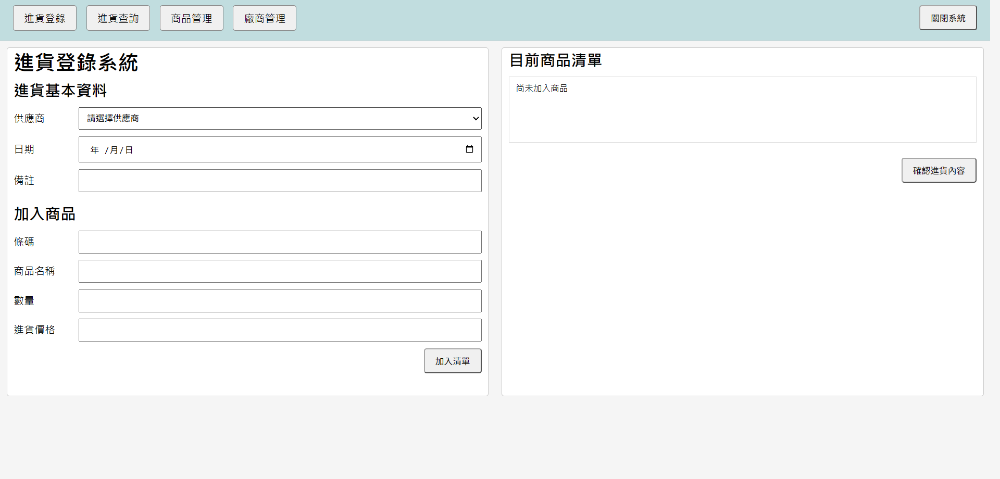
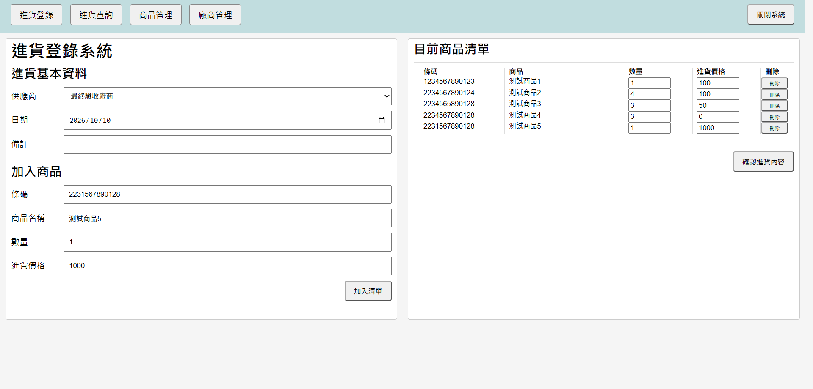
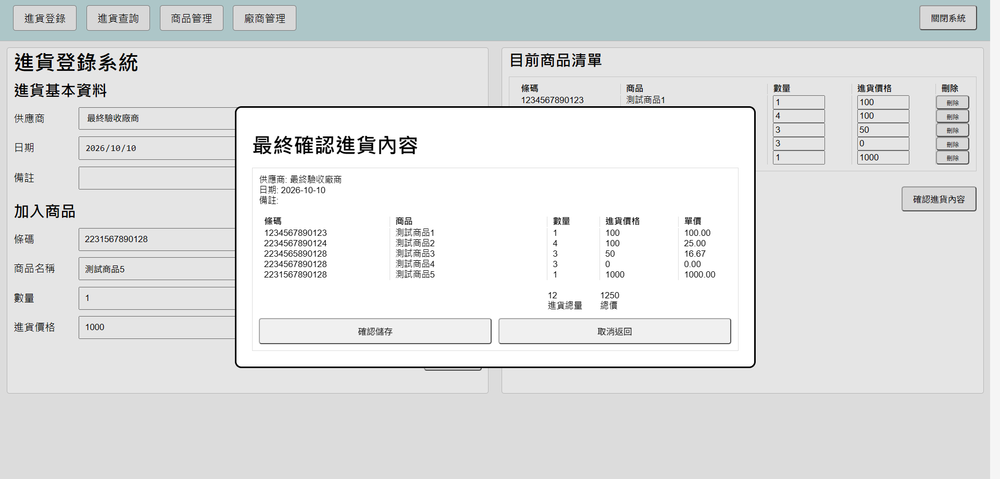
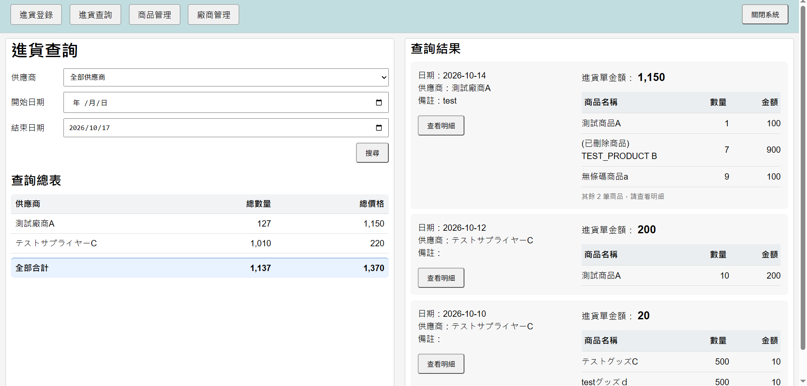
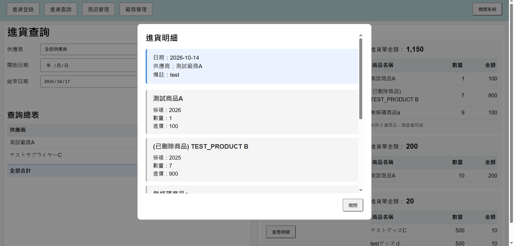
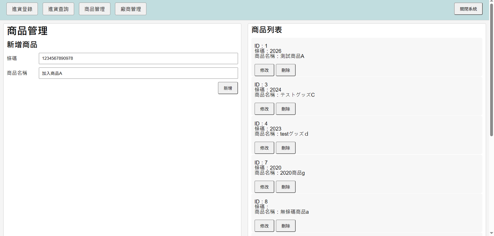
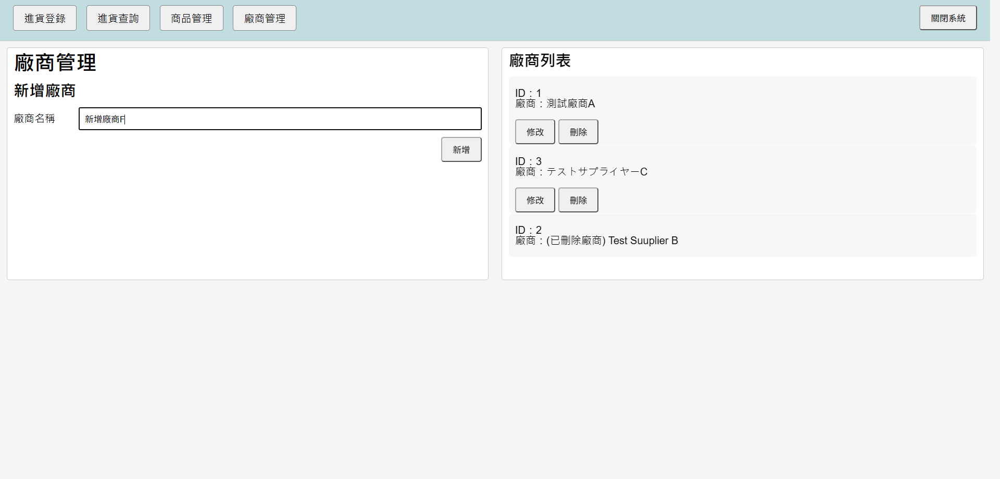
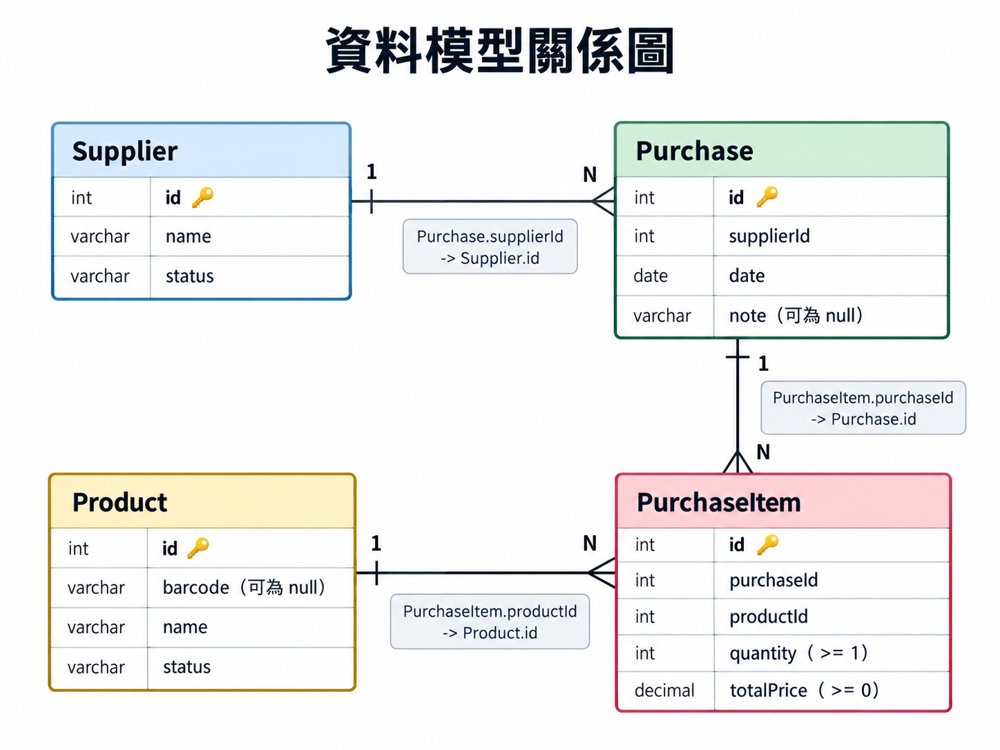

# Purchase System

## 1. 簡介
這是一個用於管理進貨登錄的簡易程式。
提供了簡易的登錄、查詢功能。
只要電腦可以運行 Java 的話，不需要另外安裝其他程式即可使用。

---

## 2. 用途及操作
程式目前提供了以下的簡易功能
1) 進貨單的登錄、查詢
2) 商品資料的建立、查詢、修改、刪除
3) 廠商資料的建立、查詢、修改、刪除

操作方式也很簡單
1) 執行「啟動系統.bat」
2) 等待程式執行，會自動開啟網頁
3) 在畫面上方選擇要使用的功能開始進行操作
4) 關閉時按下操作畫面上方的[關閉系統]即可關閉

---

以下為簡易的操作方式

### 進貨登錄
（進貨登錄 - 基本資料）
1) 選擇供應商
2) 選擇日期
3) 可以加入這筆進貨單的備註

（進貨登錄 - 加入商品）
1) 全新商品可以在此直接加入，會自動進行新商品的登錄
2) 可以輸入條碼
3) 輸入商品名稱
 ※請注意，如果是【既有商品】而且有條碼的話
 　登錄後的商品名稱會以既有名稱為主
 　程式不允許建立同名商品，目前也尚未提供無條碼既有商品的選取功能
4) 輸入數量，最少是1
5) 輸入進貨價格，最少是0
6) 輸入完畢後按下[加入清單]就會放到右側的暫時清單

（進貨登錄 - 目前商品清單）
1) 可以確認目前登錄的商品資訊
2) 可以修改數量，最少是1
3) 可以修改商品進貨的總價格，最少是0
4) 可以移除整筆商品
5) 確認完畢後按下[確認進貨內容]就會跳出小視窗

（進貨登錄 - 最終確認進貨內容）
1) 確認進貨單資訊
2) 確認無誤的話，按下[確認儲存]，就會將進貨單登錄
3) 確認有問題的話，按下[取消返回]，就會回到原本頁面

---

### 進貨查詢
（進貨查詢）
1) 選擇供應商
2) 選擇查詢的開始日期
3) 選擇查詢的結束日期
 ※如果沒有選擇，會視為不限制 開始/結束 的日期
4) 按下[搜尋]

（進貨查詢 - 查詢總表）
1) 提供搜尋範圍內的「供應商」及對應的「進貨單總額」「進貨單總數量」

（進貨查詢 - 查詢結果）
1) 提供查詢結果的各筆進貨單「日期」「供應商」「備註」「進貨單金額」及「進貨單內前 3 筆商品資訊」
2) 按下[查看明細]就會跳出小視窗

（進貨查詢 - 進貨明細）
1) 提供此筆進貨單登錄時的所有資訊

---

### 商品管理
（商品管理 - 新增商品）
1) 可以輸入條碼
2) 輸入商品名稱
 ※程式不允許建立同條碼商品、或是同名商品
3) 按下[新增]，就會將商品登錄

（商品管理 - 商品列表）
1) 提供所有商品及對應資訊
2) 可以按下[修改]，就會跳出輸入視窗；可以進行修改「條碼」「商品名稱」
3) 可以按下[刪除]，就會跳出確認視窗；可以進行商品的刪除
 ※已刪除商品將被標註特殊名稱，不會影響歷史進貨單的資料

---

### 廠商管理
（廠商管理 - 新增廠商）
1) 輸入廠商名稱
 ※程式不允許建立同名廠商
2) 按下[新增]，就會將廠商登錄

（廠商管理 - 廠商列表）
1) 提供所有廠商及對應資訊
2) 可以按下[修改]，就會跳出輸入視窗；可以進行修改「廠商名稱」
3) 可以按下[刪除]，就會跳出確認視窗；可以進行廠商的刪除
 ※已刪除廠商將被標註特殊名稱，不會影響歷史進貨單的正確資料

---

## 3. 系統架構及使用技術

### 使用技術
本程式是使用 Java + Spring Boot 搭配 HTML + JavaScript + CSS 完成的網頁程式。 
使用 Spring Boot 內嵌的 Web Server，port 設定在 8086。 
資料的持久化採用 .csv 檔案。 

Java 版本使用的是 Java 21。 
Spring Boot 主要負責處理 HTTP 的請求、Controller 的路由及依賴注入。 
前端主要交由 JavaScript 進行網頁的互動及發送 HTTP 請求與後端溝通。 
使用者介面的部份則是交由 HTML 呈現與 CSS 美化。 
程式在執行時會在程式目錄底下自動建立 data 資料夾，並將程式輸出的資料保存為 .csv 檔案。 

---

### 系統架構
程式啟動時會先啟動 Spring，Spring 啟動時會開始建立 Repository、Service、Controller 三大類別作為 Bean 管理。 
Bean 中的 Repository 目前會自動讀取 data 下對應的 .csv 檔案，作為集合 Map 的形式保存在記憶體中管理。 

使用者在輸入完資料後，前端會由 JavaScript 蒐集起來變為 json 的格式，並以 fetch 的方式向後端送出 HTTP 請求。 
後端的 Spring 會將 json 反序列化並依照路由呼叫後端 Controller。 
後端主要是三層分立，Controller 負責處理 HTTP 的請求與回應， Service 負責商業邏輯及行為，Repository 則是資料的讀寫。 
第一層的 Controller 會被 Spring 依照路由呼叫，在處理請求時候呼叫對應的 Service 處理。 
第二層的 Service 層會依照呼叫方法來進行商業邏輯判斷，之後依照判斷結果呼叫對應的 Repository 。 
第三層的 Repository 層依照呼叫的方法修改 Map 及寫入 .csv 檔案，並將結果回傳給 Service 層。 
Service 層再回傳給 Controller ，Controller 交由 Spring 依照回傳結果序列化成 json 並回應給前端 JavaScript。 
前端的 JavaScript 再依照 json 處理資料交由使用者。 

---

### 資料儲存與設計

#### 主要資料模型

##### 1. Supplier
用來識別資料唯一的[id] 跟商業邏輯上需要的 廠商名稱[name], 資料狀態[status]。
 其中的 status 由 ModelStatus enum 管理。

##### 2. Product
用來識別資料唯一的[id] 跟商業邏輯上需要的 商品條碼[barcode], 商品名稱[name], 資料狀態[status]。
 其中的 barcode 允許 null, status 由 ModelStatus enum 管理。

##### 3. Purchase
用來識別資料唯一的[id] 跟商業邏輯上需要的 供應商id[supplierId], 進貨單日期[date], 備註[note]。
 其中的 supplierId 會對應上 Supplier.id
 　　　 note 允許 null。

##### 4. PurchaseItem
用來識別資料唯一的[id] 跟商業邏輯上需要的 進貨單id[purchaseId], 商品id[productId], 進貨數量[quantity], 進貨總價[totalPrice]。
 其中的 purchaseId, productId 會對應上 Purchase.id, Product.id，
 　　　 quantity >= 1, totalPrice >= 0。

---

#### 資料的儲存與還原
．程式執行時的運作

資料的模型儲存時，會交由對應的 Repository 進行寫入方法的呼叫。
 目前資料持久化是以 CSV 檔案格式儲存在 data 底下，以 append 最後一行的方式紀錄資料的修改。

主要分為三大類型，交由 CsvStatusType enum 管理。
- CREATE：建立全新資料模型，會自動建立最新的id。
- UPDATE：修改已有資料模型，會確認舊有id存在。
- DELETE：邏輯刪除已有資料模型，會確認舊有id存在。
※並非所有資料模型都支援上述操作

寫入時會紀錄上述 type 以及模型資料的方式紀錄。 
type 及各資料以 "," 分隔，每筆紀錄以換行分隔。 
確認寫入成功後，會以 Map.put() 的方法將新資料加入記憶體，或是取代取代掉記憶體中的舊資料。 

．程式啟動時的運作

Repository 目前建構時會自動讀取 data 底下的 csv 檔案，如果 資料夾/檔案 不存在就會自動建立。 
讀取的檔案會以逐行的方式讀取，並進行字串的切割、資料型態的轉換，最後以 `Map<id, 資料模型>` 的形式儲存在執行的記憶體中。 
以下依照讀取到的 type 類型說明。 
- CREATE：確認 Map 中沒有相同 id 時才進行動作，將資料 put，部分模型會將 status 設定為 ACTIVE。
- UPDATE：確認 Map 中已有相同 id 時才進行動作，將資料 put 取代舊有資料。
- DELETE：確認 Map 中已有相同 id 時才進行動作，將資料 put，部分模型會將 status 設定為 DOWN。
 ※並非所有資料模型都支援上述操作

---

## 4. 目前限制與後續開發
### 目前限制
1) CSV 檔案的特殊字元處理
2) 沒有 Rollback 功能
3) 自動化測試不足

---

### 後續開發
#### 整體
．美化
1) 顏色調整

．功能
1) 資料庫支援

#### 進貨登錄系統
．美化
1) h2文字對齊調整
2) 過長資料提供範圍內滾動條

．功能
1) 既有商品可以下拉選擇；提供使用者便利性
2) 防止加入同條碼不同名商品，既有條碼要加入清單時跳出提示並帶入商品名稱
3) 防止加入無條碼同名商品，既有商品要加入清單時跳出提示並帶入商品名稱

#### 進貨查詢
．美化
1) 過長資料提供範圍內滾動條
2) 查詢結果調整備註顯示及日期供應商排版，讓備註能夠完整
3) 查看明細的進貨明細版面調整

．功能
1) 新增商品查詢條件
2) 新增進貨單刪除

#### 商品管理
．美化
1) h2文字對齊調整

．功能
1) 新增條碼查詢功能
2) 新增名稱查詢功能

#### 廠商管理
．美化
1) h2文字對齊調整

．功能
1) 新增名稱查詢功能